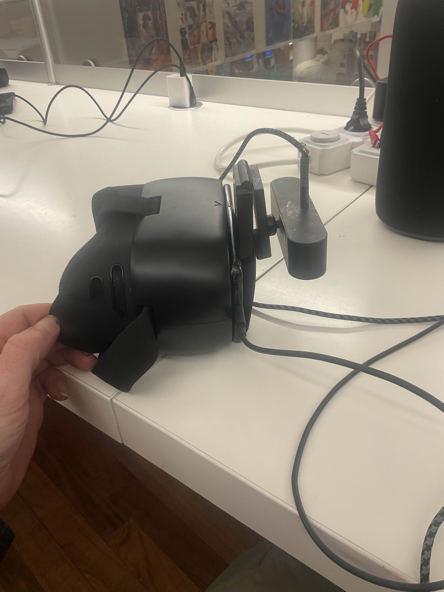

# ScrapVR

**VR from scrap.** An old phone in a cheap phone headset, a webcam taped to the front, and a PC
that renders. No VR headset bought, no controllers. Built in public: the working parts, the
failed attempts and every bug we hit along the way are all in here.

```
 PC (renders the game in side-by-side stereo)
  │  Sunshine ──video──> Moonlight on the phone (USB tether)
  │
  │  <── UDP 16061 ── phone gyro        ─┐
  │  <── UDP 16061 ── tracker (on PC) <──┤ webcam on the headset: head position + hands
  │                                      │
 Phone in a headset: screen = display, gyro = head rotation, rear camera = the eye view
```



## What works today

| Part | Status |
|---|---|
| Stereo view streamed to the phone (Sunshine → Moonlight over a USB tether) | works |
| Head rotation from the phone gyro ([android/](android/)) | works |
| Webcam lens calibration on a tablet screen (no printer) | works, 0.1 px reprojection error |
| Head position from an ArUco marker, fused with the gyro's rotation | works on the bench, not yet proven in a full session |
| Hand tracking (MediaPipe): 21 joints per hand, pinch, fist | works when the whole hand is in view; placement still drifts with distance |
| Self-healing link: dead tether, dropped stream and error dialogs fixed over adb ([tracker/phone_watchdog.py](tracker/phone_watchdog.py)) | works, verified on a real cable trip |
| Measuring where the webcam sits relative to your eyes | in progress: see [docs/CALIBRATION.md](docs/CALIBRATION.md) |

## Hardware we use

- A Galaxy S9 (any Android phone with a gyroscope should do) in a generic phone VR headset
- A Lenovo 510 FHD webcam (RGB + IR) mounted on the front of the headset
- A Windows PC running [Sunshine](https://github.com/LizardByte/Sunshine); [Moonlight](https://moonlight-stream.org/) on the phone
- A tablet showing the ArUco marker and the calibration chessboard ([assets/](assets/))
- One USB-C cable; a Raspberry Pi Ethernet bridge is next

## Repo layout

| Path | What |
|---|---|
| [android/](android/) | Phone app: streams the gyro, serves the rear camera for calibration. Plain SDK build, no Gradle |
| [tracker/](tracker/) | PC side: webcam capture, head marker, hands, calibrations, self-tests, the phone watchdog |
| [tests/](tests/) | Synthetic tests: rendered marker and board scenes with known answers |
| [assets/](assets/) | Marker, chessboard and a true-size printable PDF |
| [docs/](docs/) | [Setup](docs/SETUP.md) · [Protocol](docs/PROTOCOL.md) · [Calibration](docs/CALIBRATION.md) · [Lessons](docs/LESSONS.md) · [Roadmap](docs/ROADMAP.md) |

The VR view itself is rendered by the game on the PC: any engine that can read the UDP
messages in [docs/PROTOCOL.md](docs/PROTOCOL.md). A standalone Godot receiver is on the
[roadmap](docs/ROADMAP.md).

## Demonstration and downloads

[Watch the hand-tracking demo](media/README.md) · [Download ScrapVR Pose APK](android/apk/README.md) · [Early wired-display experiment and ADB recovery](docs/EARLY-EXPERIMENTS.md)

## Quick start

```powershell
python -m venv .venv; .venv\Scripts\activate
pip install -r requirements.txt
python tools/download_models.py           # MediaPipe hand model
python tracker/head_tracker.py --selftest  # no camera needed
```

Then follow [docs/SETUP.md](docs/SETUP.md) for the phone, the stream and the calibrations.

## Built in public

This is a side project by **RoundUP studio**, built in the open with two AI coding assistants
checking each other's work. Expect rough edges, honest status, and the reasoning behind
each decision in [docs/](docs/).

## License

MIT, see [LICENSE](LICENSE). The MediaPipe hand model is Google's (Apache 2.0) and is
downloaded, not redistributed.


